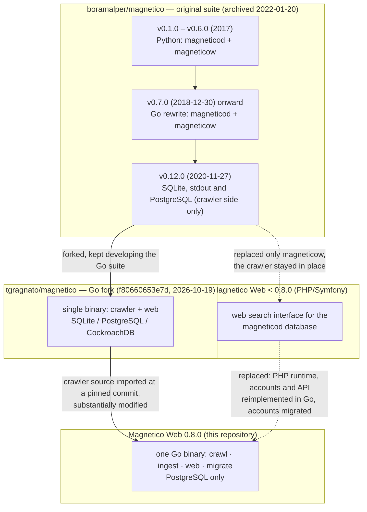
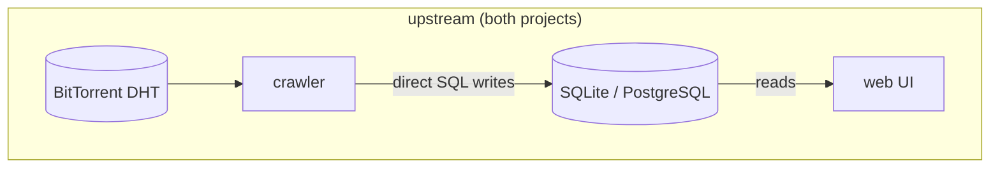
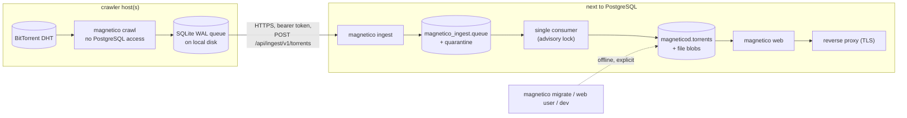
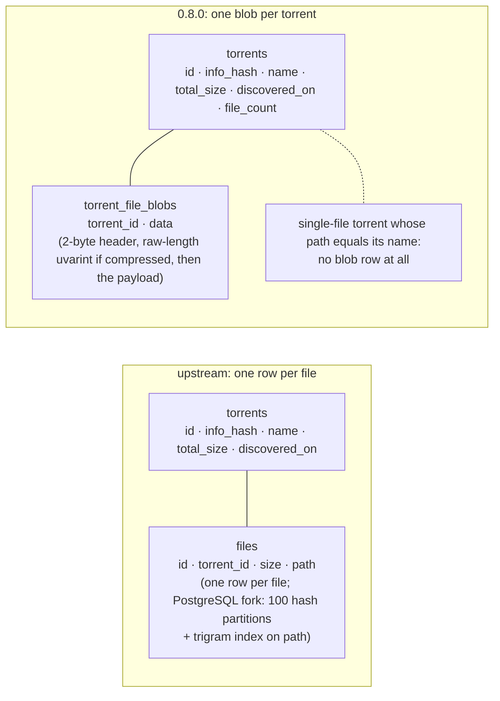
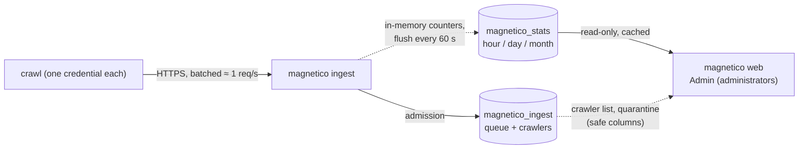
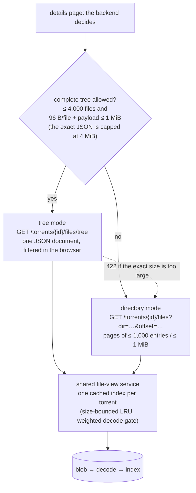
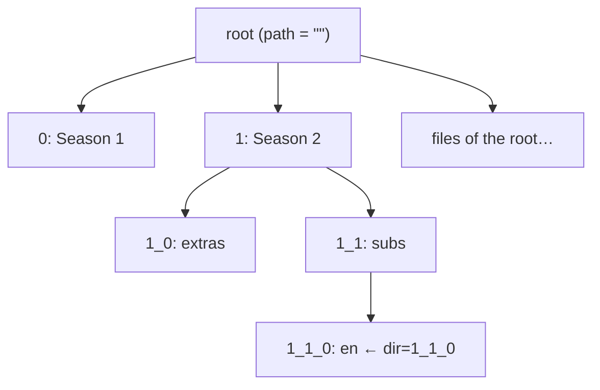

# How Magnetico Web 0.8.0 differs from `boramalper/magnetico` and `tgragnato/magnetico`

**Last updated: 2026-11-25.**

This page explains what the unified Go implementation in this repository (Magnetico Web **0.8.0**, still unreleased at the date above) does differently from the two projects it descends from, and why. It describes **implemented behaviour only**. Things that are planned, researched or deliberately refused are listed separately in [§9](#9-non-goals-and-deferred-topics) and are not promises.

Statements about the other projects are tied to identifiable versions:

| Project | Version used here |
|---|---|
| [`boramalper/magnetico`](https://github.com/boramalper/magnetico) | tag **v0.12.0** (`915700a6`, 2020-11-27) for the code that matters to the migration; the archived `master` (`5546a941`, 2022-01-20, "Archival Notice") is the project's last state |
| [`tgragnato/magnetico`](https://github.com/tgragnato/magnetico) | commit **`f80660653e7d`** (2026-10-19), the snapshot this repository imported (merge `fa7a749c`) |
| Historical **Magnetico Web** (PHP) | the `0.7.x` application on this repository's `master` (last PHP code commit `3d2aa697`; `master` tip `0c7b2cb6`, 2026-11-21) |
| Magnetico Web **0.8.0** | the branch `refactor/0.8.0-unify-and-new-storage` |

Where a number comes from a measurement, the dataset, configuration and report are named. Nothing here is a claim about production-scale performance.

Contents: [1 lineage](#1-project-lineage) · [2 at a glance](#2-comparison-at-a-glance) · [3 services](#3-one-codebase-separately-deployed-services) · [4 storage](#4-storage) · [5 ingestion](#5-crawling-and-ingestion) · [6 migration](#6-migration) · [7 web](#7-the-web-interface-and-its-interfaces) · [8 deployment](#8-deployment) · [9 non-goals](#9-non-goals-and-deferred-topics)

---

## 1. Project lineage

Four things are easy to confuse: the original crawler-and-web suite, the Go fork that kept developing it, the PHP web interface that replaced only the original web part, and this unified implementation.



Reading the diagram:

- **`boramalper/magnetico`** was first written in **Python** (`magneticod` crawler and `magneticow` web interface, v0.1.0–v0.6.0, 2017) and rewritten in **Go** from v0.7.0 (2018-12-30). It stopped with an archival notice in January 2022. Its v0.12.0 offers SQLite (the default), a stdout engine and a PostgreSQL engine that, in the project's own words, implements "only the `magneticod` part": the original web interface did not work with PostgreSQL.
- **`tgragnato/magnetico`** is a Go fork of that suite. At the imported commit it is a single binary with a crawler and a web interface, backed by SQLite, PostgreSQL or CockroachDB, and published as an OCI image on GHCR.
- **The historical PHP Magnetico Web was not a crawler.** It replaced `magneticow` only. It was "a simple web search interface for the magneticod database": a Symfony application that read the schema written by the *unchanged* Go crawler, and kept its own accounts in a second database. The crawler stayed exactly where it was.
- **Magnetico Web 0.8.0** imports the `tgragnato` Go code at a pinned commit (the crawler's DHT and metadata code, with the AGPL-3.0 licence and notices kept), removes what it does not need (the upstream web UI and Basic Auth, the other storage backends, the JSONL export/import, the old automatic schema migration) and adds everything else described below. It also **replaces the PHP runtime**: the web interface, accounts, API and RSS feeds are reimplemented in Go.

### The real deployment is not the same thing as the lineage

The lineage above is the history of the *code*. The system the maintainer runs in production, and migrates **from**, is: the long-running legacy **Go** Magnetico crawler (the original v0.12.0 PostgreSQL layout) paired with the **PHP** Magnetico Web. No Python Magnetico installation is involved. The torrent migrator reads exactly that layout (`docs/specs/legacy-torrent-migration-v1.md`): schema `magneticod`, `torrents(id, info_hash, name, total_size, discovered_on)`, an ordinary unpartitioned `files(id, torrent_id, size, path)` table, and `migrations(schema_version)` which must be `0`; the partitioned layout of the `tgragnato` fork is refused. The user migration reads the PHP application's own database (`docs/migration_0.8.0.md`).

---

## 2. Comparison at a glance

| | `boramalper` v0.12.0 | `tgragnato` @ `f8066065` | Magnetico Web 0.8.0 |
|---|---|---|---|
| Language(s) | Go (Python before v0.7.0) | Go | Go only (the PHP web is gone) |
| Executables | `magneticod`, `magneticow` | one binary, crawler + web | **one binary**, services chosen by subcommand: `crawl`, `ingest`, `web`, `migrate`, `dev` |
| Storage | SQLite (default), PostgreSQL (crawler only), stdout | SQLite (FTS5), PostgreSQL, CockroachDB | **PostgreSQL only** |
| File lists | one row per file | one row per file (PostgreSQL: 100 hash partitions and a trigram index on paths) | **one compact, versioned blob per torrent**; single-file torrents with no blob |
| Crawler → storage | the crawler writes the database directly | the crawler writes the database directly | crawler has **no PostgreSQL access**: durable local SQLite queue → HTTP → ingest → PostgreSQL queue → single consumer |
| Several crawlers | each needs database access | each needs database access | any number of crawler hosts deliver to one ingest endpoint over HTTPS |
| Crawler identity | — | — | **one revocable credential per crawler** (`mgc_…`, SHA-256 only at rest, bounded 60 s propagation), operator CLI `magnetico ingest crawler …` |
| Operational visibility | stdout logs | logs | **ingest statistics** persisted as hourly/daily/monthly aggregates in `magnetico_stats`, and a **read-only administrator section** with charts, crawler, quarantine, user, invitation and tracker listings |
| Web access | Basic Auth from a credentials file; no accounts | (upstream web UI, Basic Auth) | **private, authenticated**; accounts, sessions, invitation-only registration |
| Search | SQLite FTS5 (the PostgreSQL engine has no web interface) | trigram index on names (PostgreSQL), FTS5 (SQLite) | case-insensitive substring match on names; keyset pagination; no result count |
| File browsing | whole list on one page | whole list on one page | backend-selected **complete tree** or **paginated directories**, positional directory paths |
| API | REST (SwaggerHub-documented) | upstream `/api/v0.1` | REST **API v2** (bearer tokens, embedded OpenAPI 3.2); legacy JSON API **not** restored |
| Feeds | none | RSS | RSS **v2** (own token) and **v1** kept for existing clients |
| Schema changes | automatic migration in the crawler | automatic migration v0→v1 | **never automatic**: explicit `schema-init` commands; fail closed |
| Moving old data | — | — | offline `migrate torrents` (checkpointed, resumable) and `migrate users` (one transaction: all or nothing, not resumable), two verifications, forensic export |
| Deployment | binaries, Docker images | OCI image on GHCR | native Linux (amd64, arm64) binaries on Forgejo releases and **one universal multi-platform OCI image** (`docker.io/skobkin/magnetico-web`, `ghcr.io/skobkin/magnetico-web`, user `10001:10001`, every subcommand); build and publication **configured and verified locally, nothing published yet** |

---

## 3. One codebase, separately deployed services





**What changed.** Upstream shipped a crawler and a web interface (the fork as one binary, the original as two). 0.8.0 is one codebase and one executable whose subcommands are *separately deployed* services: `crawl` on a DHT-capable host, `ingest` and `web` next to PostgreSQL, `migrate` for offline work. The crawler no longer has any PostgreSQL access (it keeps only its own local SQLite delivery queue and talks to `ingest` over HTTPS).

**Why.** A DHT crawler needs inbound UDP and many outbound connections; it does not need to sit next to the database, and should not be able to damage it. Separating the roles lets the crawler run on a different machine, and lets the web service run as a small, privacy-minded process.

**Trade-offs.** More moving parts than a single-process install, and a network hop (with its failure modes) between crawler and database. There is no embedded, zero-configuration mode any more.

---

## 4. Storage

### 4.1 PostgreSQL only

**What changed.** SQLite, CockroachDB, RabbitMQ, ZeroMQ, Bitmagnet and the JSONL modes of the fork are removed; PostgreSQL (developed and tested against 17, with the `pg_trgm` extension) is the only backend.

**Why.** One backend can be specified, tested against real instances and migrated from; the web service needs `pg_trgm` and keyset queries; several backends would multiply the data-compatibility promises.

**Trade-offs.** PostgreSQL is a heavier dependency than a SQLite file, and there is no path for other backends in 0.8.0 (adding one is an explicit non-goal for now).

### 4.2 Compact file-list blobs instead of one row per file



**What changed.** The file list of a torrent is stored as **one blob** in a versioned binary format (`docs/specs/wire-format-v1.md`): a two-byte header (version; serializer and compressor IDs), a raw-length `uvarint` only when the payload is compressed, then a payload that is a plain list, a **prefix-delta** list or a **trie**, compressed with Zstd or Brotli according to a **codec profile** (`balanced`: prefix-delta + Zstd; `compact`, the default: prefix-delta or trie + Brotli q9; `maximum`: Brotli q11). The encoder tries the candidates and keeps the smallest. A torrent whose only file has a path equal to its name and a size equal to the total (the very common single-file case) is stored **without any blob**. The name search and listing never touch blobs.

**Why.** On the lab sample of the real library the file table dominates the storage and index cost, and a search engine for *names* never needs it in the hot path. A blob that is read only when a torrent is opened removes the file table, its partitions and its path index.

**Measured.** The only real-data figure is the 04B migration run on the maintainer's lab sample (`docs/wip/04B-verification-recovery-report.md`, run at repository tip `28f995f5`, 2026-11-09; **codec profile `compact`**; the report does not record a separate codec revision, and the later pooled-Brotli determinism fix `bf7d78ef` of 2026-11-21 changed neither profiles nor selection): the restored source database held **3,457,046 torrents and 123,460,039 files, 17 GB**; the migrated target was **2.9 GB**, which the report states as a compression of "~5.9×" for the dataset. Of the source torrents, **2,247,594 got a blob** and **1,209,452** were single-file torrents stored without one. The report gives these as database sizes of the two databases; it does not state the measuring query, and it does not separate the compressed payload from indexes and heap, so the figure must not be read as a codec compression ratio. Encoding cost (same repository, `go test ./codec -bench Encode`, `docs/wip/storage-implementation-report.md`, an 8-vCPU lab host): 50,000-file lists took about 30 ms (`balanced`), 271 ms (`compact`) and 2.61 s (`maximum`).

**Trade-offs.**
- **No file-name search.** Because paths are not indexed, searching *inside* torrents is not possible. The upstream fork had a path index; 0.8.0 deliberately does not (see §9).
- Opening a torrent's files means fetching and decoding a blob. The web service bounds this with a weighted decode gate and a size-limited index cache (§7.3).
- Byte-identical encoding across future codec or dependency upgrades is **not** a compatibility requirement; **backward-compatible decoding is**. Deterministic encoding (and a pooled Brotli writer) are kept where practical.
- The blob format is a long-term compatibility promise of its own (`wire-format-v1`).

### 4.3 Schema changes are explicit

**What changed.** The fork migrated its own schema automatically (and created 100 `files` partitions). 0.8.0 never changes a schema on its own: `migrate schema-init`, `web-schema-init` and `ingest-schema-init` create schemas on fresh databases and refuse anything else; every service verifies its schema at start-up and **fails closed**.

**Why.** A crawler that silently reshapes a multi-million-row database on upgrade is a hazard; with explicit commands an operator knows when the schema changes.

**Trade-offs.** Upgrades need a deliberate step, and an incompatible database stops the service instead of "fixing" itself.

---

## 5. Crawling and ingestion

```mermaid
sequenceDiagram
  autonumber
  participant D as DHT
  participant C as crawl (host A, B, …)
  participant I as ingest
  participant L as local SQLite WAL queue
  participant P as PostgreSQL queue
  participant K as single consumer
  participant T as torrents + blobs
  D->>C: announced info hash
  C->>I: POST exists (batched hashes), before any metadata fetch
  I-->>C: exists / missing / unknown
  Note over C: exists: skipped. missing and unknown: admitted (unknown = fail-open)
  C->>D: fetch metadata from peers (admission gate: leech slot and queue room)
  C->>L: metadata record, committed (synchronous=FULL)
  L->>I: POST torrents (the admitted records)
  I->>P: INSERT, quota check, COMMIT
  I-->>L: 202 Accepted (durable)
  Note over L: record deleted locally only after 202
  K->>P: take a batch (advisory lock held)
  K->>T: AddTorrent (validate, encode, store)
  K->>P: DELETE the processed rows
  Note over K,P: invalid → quarantine; I/O error → backoff
```

**Direct persistence versus the durable pipeline.** In the upstream projects the crawler opens the database and writes each torrent as it is discovered. In 0.8.0:

1. **Crawler-local durable queue.** `crawl` keeps discovered metadata in a **SQLite database in WAL mode with `synchronous=FULL`** on its own disk. A record counts as admitted only once it is committed there, and is deleted only after the ingest service answered `202`. A DHT crawler therefore survives restarts, network outages and database downtime without losing any **durably admitted** record. Metadata that was only in memory (leeches in flight, a full local queue, the last seconds before a shutdown) is not covered: it is dropped, counted and logged, and the torrent can be discovered again. (SQLite is used here, *only* as the crawler's local queue; it is not a storage backend of the product.)
2. **Centralised ingest.** Many crawlers may deliver to one `ingest` service over authenticated HTTPS (bearer token from the environment). `ingest` answers existence checks, which the crawler asks **before it fetches metadata** (and so before local queue admission), so it does not refetch what is already stored; a lookup that fails is reported as `unknown` and the crawler treats it as not stored (**fail-open**: the duplicate work is harmless because storage is idempotent). It accepts records all-or-nothing.
3. **PostgreSQL ingest queue, consumer and quarantine.** `202` is sent only after the record is committed to `magnetico_ingest.queue`, under a transactional **byte quota**. A **single consumer** (a PostgreSQL advisory lock guarantees there is only one) validates, encodes and stores torrents in batches; records that can never be stored go to `quarantine`; transient I/O errors back off.

**Ingest existence cache.** `ingest` keeps a process-local cache in front of the existence lookup: a **plain LRU** (not CLOCK, SIEVE or TinyLFU) over 20-byte hashes, with an **8 MiB default budget** (about 87,000 entries at 96 B each). A positive entry ("stored") **never expires**: the torrent store is append-only, so the answer cannot become false; only eviction (or a restart) removes it. A negative entry ("missing") lives about **20 seconds** so a torrent stored moments later is noticed. Errors are never cached, and a late "missing" never downgrades a positive entry. *Why:* simple, bounded and predictable memory that matches append-only data; smarter admission policies were deliberately deferred. *Trade-off:* the cache can only help with hashes seen recently, and a positive answer says nothing about the database being reachable right now.

**Per-crawler credentials, batched delivery and statistics.** `ingest` authenticates each crawler with its own credential (`mgc_` and 32 random bytes; only the SHA-256 digest is stored in `magnetico_ingest.crawlers`). A positive result is cached for exactly 60 seconds from the moment the database was asked, so a rotation or disable reaches every running instance within a minute; lookups are bounded (8 at a time, immediate `503` beyond the bounds) so a flood of invalid tokens cannot exhaust PostgreSQL, and a storage failure is a `503`, never a false `401`. The crawler batches its requests by time (about one request per second per endpoint instead of one per record), dispatching early when the next record would not fit. `ingest` counts its own operation in memory (one mutex, never held across database I/O) and persists hourly, daily and monthly aggregates once a minute through an idempotent, single-arbiter flush protocol into an optional `magnetico_stats` schema; the `web` service reads them into a **read-only** administrator section. Statistics never store a payload, hash, name, path or credential, and their failure never changes an admission or authentication decision.



*Trade-offs.* A running ingest honours a revoked credential for up to 60 s; the statistics are operational telemetry, not an audit log (a crash loses up to one flush interval, an outage buffers at most 26 hours); there are no administrator mutations in 0.8.0 (credentials, users, invitations and trackers are changed with the command line). Measurements: `docs/wip/09-statistics-admin-report.md`.

**Why the pipeline.** Delivery guarantees for durably admitted records (crash-safe on both sides, at-least-once; best-effort before admission), several crawlers, a crawler without PostgreSQL credentials, and bounded memory on the ingest side (the quota and queue bound what a burst can cost).

**Trade-offs and limits.** More components and failure modes than direct writes; at-least-once delivery means the same torrent can be offered twice (stored idempotently by info hash); the queue quota must be sized for the longest expected database outage. **Live-DHT acceptance of the whole chain has not been run** (it is part of the release-candidate phase); the pipeline was qualified on synthetic data with 2-hour soaks, large-record and multi-crawler runs (`docs/wip/06-crawler-ingest-results.md`).

---

## 6. Migration

**What changed.** Upstream had no migration story beyond the fork's automatic in-place upgrade. 0.8.0 ships an **offline** toolchain that moves an original v0.12.0 PostgreSQL database and the PHP application's accounts into a **fresh** 0.8.0 database:

- `migrate torrents`: checkpointed and **resumable** (kill it, rerun the same command), all-or-nothing batches, a durable error registry in a `magnetico_migration` schema, the source treated strictly as read-only, every id, hash, name, size, time and the complete file list (duplicates included) preserved.
- `migrate verify-decode` (target only) and `migrate verify-content` (a full source ↔ target equality scan); `migrate torrents retry-errors`; `migrate errors export` (a forensic JSONL export); and a gated `migrate cleanup` that is optional and never the default.
- `migrate users`: one target transaction; ids and relationships kept, legacy password hashes verified directly and upgraded on first login, legacy API tokens become **RSS tokens only**, a read-only `--dry-run` with a plan digest bound to the source data.

**Measured.** The torrent toolchain was run end to end on the real lab sample (3,457,046 torrents, 123,460,039 files) with fault injection (process kills in every phase, connection loss, source drift, container restarts) and finished with a full source ↔ target equality pass (`docs/wip/04D-end-to-end-validation-report.md`). The user migration has **not** run on real accounts.

**Why.** The data (millions of rows, found over years) cannot be re-crawled quickly, and the user accounts must keep working.

**Trade-offs.** The migration is **offline** (the legacy application must stop writing), it needs a fresh target, and the destructive options are guarded by plan digests and confirmation flags. After ingest has stored its first new torrent, the migration's own cleanup is no longer possible (a documented gate), and re-verifying against the source is no longer meaningful.

---

## 7. The web interface and its interfaces

### 7.1 Private, authenticated, invitation-only

**What changed.** The original web interface had no accounts (Basic Auth from a credentials file). The PHP Magnetico Web added accounts. 0.8.0 is a **private** service: every page except sign-in, registration, password recovery and the public magnet short link requires a session; registration is by **invitation** only; roles are `user` and `admin` (administration is done with an operator CLI, there is no admin UI yet). Sessions are server-side, cookies are `Secure`, `HttpOnly` and `__Host-` prefixed in production, CSRF protection covers every state-changing request, passwords are Argon2id, and sign-in, recovery and token use are rate limited.

**Why private.** BitTorrent is a general-purpose distribution protocol, but its use is frequently misunderstood and frowned upon in some contexts. Although this project indexes torrent metadata and does not download or distribute the referenced content, unrestricted public access is intentionally not supported at the time of writing, to avoid unnecessary misunderstandings. Registration is therefore invitation-only.

**Trade-offs.** It is not a public search engine, and there is no self-service sign-up. Rate limits and the mail queue live in one process, so the first deployment is **one web instance**.

### 7.2 Search and pagination

- **Search** splits the query on white space, ignores words shorter than three characters and requires every remaining word to occur (case-insensitively, `%` and `_` literal) in the torrent **name**. A query that is exactly 40 hexadecimal characters is an exact info-hash lookup; ordinary name searches issue no hash lookup and carry no hash predicate (asserted by a test that traces the SQL).
- **Keyset pagination.** Results are paged with opaque cursors over `(sort key, id)`, in both directions, with `id` as the tie-breaker. The query fetches **`LIMIT n+1`** rows to learn whether another page exists; **there is no `COUNT(*)` and no `OFFSET`**, so the interface shows no total result count. *Why:* a total count over millions of rows is expensive, and offsets drift when torrents are inserted continuously; the PHP application used a pageless paginator for the same reason. *Trade-off:* no "page 17 of 4,000" and no jump to an arbitrary page.
- **Measured shapes.** On a synthetic dataset of 3.5 million names (`docs/wip/07J-measurements/`), typical first pages take milliseconds; two very common terms that rarely occur together are the expensive case (the planner walks the date index through the table). See the 07J report for the numbers and their limits.

### 7.3 Two file-browser modes and positional paths



**What changed.** The upstream interfaces render a torrent's whole file list. 0.8.0's backend picks, per torrent, between a **complete tree** (one JSON document, folders and a filter handled in the browser) and **paginated directory pages**, from the file count, a size estimate read from the blob header, and an exact serialization limit. Both modes use the same decoded index, so a large torrent costs one decode however it is browsed; the session UI and the bearer-token API share one implementation and are compared byte for byte in tests.

**Positional directory paths.** Directories are addressed by their **position** in a deterministic hierarchy, not by their path bytes:



A path is decimal components joined by `_` (`""` is the root, `1_1_0` is the first subdirectory of the second subdirectory of the root's second subdirectory), with subdirectories ordered by name bytes and files by canonical position. The grammar is strict (no signs or leading zeros, at most six digits, at most 256 components). *Why:* file paths are arbitrary bytes (empty components, `.` and `..`, invalid UTF-8, very long names); addressing by position means no byte sequence has to survive a URL, and no server-side registry or per-client state exists. *Trade-offs:* a directory link is only meaningful for the exact stored file list (it is immutable under the ingest contract); names travel in JSON as `name` or, when they are not valid UTF-8, `name_base64`, and the page shows control and bidirectional characters as visible markers instead of substituting anything; a hierarchy beyond 250,000 directories or 256 levels is refused (`422 index-too-complex`) for both modes.

### 7.4 REST API v2, RSS and credential separation

- **API v2** (`/api/v2`) is read-only JSON for search, details and the two file views, authenticated by a **bearer API token** only (never a cookie or a query parameter), with RFC 9457 problem responses and an embedded **OpenAPI 3.2** document that is validated against the official schema and kept equal to the routes by tests. The vendored Swagger UI works without external requests; "Try it out" is limited to `GET`.
- **RSS.** The new feed `/api/v2/feeds/latest.rss?feed_token=…` uses a **separate RSS token**. The legacy `GET /api/v1/feed/rss/last` is kept (deprecated) so existing torrent clients keep working with their existing URLs; migrated legacy tokens are RSS tokens and are accepted by **both** RSS versions (v1 `api-token` and v2 `feed_token`), and by nothing else.
- **Credential separation.** Sessions, API tokens and RSS tokens are three different credential kinds with three stores (`sessions`, `api_tokens`, `rss_tokens`); migrated legacy tokens are rows of `rss_tokens` (flagged `legacy`) and share the RSS verifier and rules. An RSS token (new or legacy) never opens the JSON API, an API token never opens a feed, a session never authenticates a bearer endpoint. Disabling an account **suspends** (does not revoke) its tokens and invitations; a password reset revokes sessions, API tokens and RSS tokens.
- **Not restored.** The legacy JSON API (`/api/v1/torrents` and friends) is **not** brought back.

*Trade-offs:* feed URLs carry a credential in the query string (so reverse-proxy access logs must not record it) because torrent clients cannot send headers; legacy tokens remain valid until revoked or reset.

---

## 8. Deployment

- **Behind a reverse proxy.** The web and ingest services speak plain HTTP and are meant to run behind a TLS-terminating reverse proxy (Traefik is the documented default). **Native TLS termination in the application is deliberately not planned.** The proxy must route only the configured public host name to the service, forward `X-Forwarded-For` from a narrow trusted set, allow at least 90 s for upstream timeouts (the search deadline is 60 s) and keep credentials out of its access logs (`docs/web-deployment.md`).
- **One PostgreSQL account by default.** The default deployment uses the same PostgreSQL account for ingest and web. A restricted runtime role for the web service is documented as optional hardening; separate least-privilege roles for ingest and web may be considered later. No schema, grant or privilege-verification contract changes because of this.
- **Source, CI and images.** Forgejo is the primary Git repository and GitHub a mirror. Woodpecker CI verifies every pull request and push and publishes release tags; native binaries go to Forgejo releases, images to Docker Hub and GHCR (Forgejo is not an OCI publication target). The publication path builds the image **once**, smoke-tests and scans exactly that build, and promotes the same digest to both registries; publication requires the verification workflow of the same commit. **Configured and verified locally (build, smoke test, scan, promotion rehearsal), but no pipeline has run on Woodpecker and no release or image has been published** (`docs/release-engineering.md`).
- **One image for every service.** `crawl`, `ingest`, `web`, `migrate` and `dev` are one executable; the OCI image is that executable on Alpine with no compiler, source tree or test harness, non-root (`10001:10001`), an exec-form entrypoint with no default command, `/data` for the crawler queue, and no universal healthcheck (the healthchecks are per service, `docs/container.md`). The original and the `tgragnato` fork ship separate or differently packaged binaries and images; the per-service healthchecks, the digest-pinned promotion and the legacy-PHP-environment warning are 0.8.0 additions, not improvements claimed over a measured baseline.
- **Front end.** The web UI uses its own CSS and vanilla JavaScript (first-party files, no framework, no CDN, no inline script); PicoCSS, which the PHP application used, is not used.
- **Resources.** Memory limits for the web container are in the 07J report and depend on the measured workload; the `GOMEMLIMIT` value and the container limit are different numbers.

---

## 9. Non-goals and deferred topics

**Deliberate non-goals** (decided; not on a roadmap):

- **Public access.** See §7.1: registration is invitation-only and the service is private on purpose.
- **Administrator mutations in the web UI** (0.8.0 ships a read-only administrator section; changes are command-line only).
- **Self-service invitation creation.** Users list, copy and revoke the invitations they were given; creating them contradicts the closed-service model (operators create them).
- **The legacy JSON API** will not be restored.
- **Native TLS termination** in the application.
- **Other database backends** in 0.8.0; PostgreSQL only.

**Deferred or speculative** (open questions, **not commitments**):

- **File-name search across torrent contents** is not a committed feature; it would need substantial research and benchmarking (indexing paths is exactly what the compact storage gave up) before it could be considered.
- **Live updating of the dashboard, crawler-side statistics, per-crawler time series and a retention command** are deferred to later releases.
- **Ingest protocol compression** may be investigated if it saves meaningful traffic at low CPU cost.
- **OAuth** may be considered for a future API v3 if there is sufficient demand.
- **A lightweight UI library** such as Preact may be considered in the more distant future; a heavy single-page-application rewrite is not planned.
- **Least-privilege PostgreSQL roles** for ingest and web, as security hardening.
- **Release engineering:** the first real Woodpecker run and the publication of a release candidate (the pipeline and image are configured, §8), a registry build cache (deliberately not configured), executing the arm64 image, and live-DHT acceptance (§8, §5).

---

*Maintenance:* this page is kept up to date whenever a significant architectural difference is introduced or changed (see `AGENTS.md`); each change updates the comparison, the rationale and trade-offs, the affected diagrams and the date at the top, keeps upstream statements tied to versions or commits, and separates implemented behaviour from planned work.
