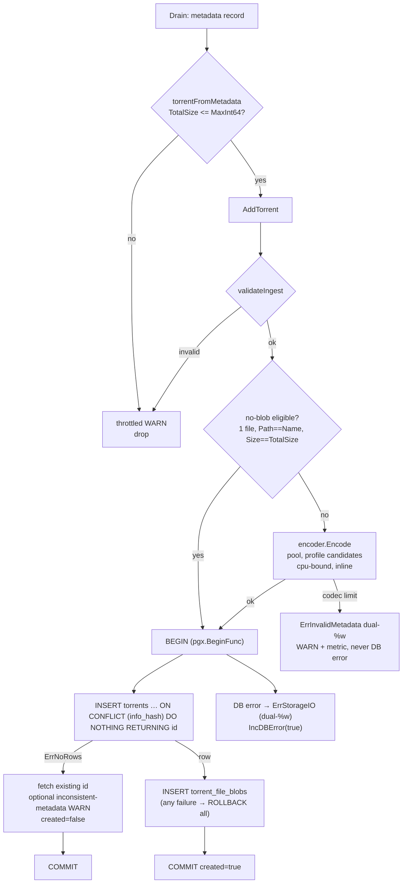

# Task 03 implementation report — codec v1 + PostgreSQL persistence

Branch `refactor/0.8.0-unify-and-new-storage`, commits 5–8 of the approved plan
(rev 4). Normative contracts: [`docs/specs/wire-format-v1.md`](../specs/wire-format-v1.md)
and [`docs/specs/postgresql-persistence-v2.md`](../specs/postgresql-persistence-v2.md);
assignment: [`docs/wip/03-storage-persistence.md`](03-storage-persistence.md).
No spec file was edited. No CI configuration was touched. Commits stay local.

## What shipped

| Commit | Content |
|---|---|
| `feat(persistence): Store contract, typed errors, ingestion validation` | `persistence/interface.go` (`Store`, `Torrent`, `TorrentQuery`, `Statistics`, `File = codec.File` alias), `errors.go`, `validate.go` — additive, tree compiled untouched |
| `feat(codec): …` (commits 1–3) | wire-format v1: minimal varints, envelope, flat + prefix-delta + directory-trie serializers, strict zstd/brotli framing, profiles, deterministic selection, encoder pool |
| `feat(metadata): v2/hybrid audit …` (commit 4) | explicit v2-only rejection, checked size accumulation, **padded multi-file hybrid support (owner stop-gate decision, see below)** |
| `feat(persistence): PostgreSQL store, schema-init, startup verification` | pgx/v5 store, advisory-locked `InitSchema`, read-only startup verification, integration harness + suites, `main.go` event-loop rewiring |
| `feat: migrate schema-init subcommand …` | `magnetico migrate schema-init` with CLI > ENV > file > defaults DSN precedence, `magnetico_invalid_metadata` counter, UTF-8/NUL metric bucket typed as `ErrInvalidTextEncoding` |

## Owner decisions implemented

- **Driver:** pgx/v5 native (`pgxpool`), one shared `codec.Encoder` per store
  (`min(4, NumCPU)` workers, semaphore-bounded).
- **`migrate schema-init`:** strictly non-destructive and concurrency-safe.
  Read-only catalog inventory **before any DDL**; creation in one transaction
  under `pg_advisory_xact_lock` with an authoritative in-transaction
  re-inventory; idempotent path verifies version rows == **exactly `{1}`**
  (never `MAX(version)`).
- **DSN never forced onto the CLI:** `--database` flag,
  `MAGNETICO_MIGRATE_DATABASE`, config-file key `migrateDatabaseURL`, in that
  precedence. Unknown `MAGNETICO_*` variables of the active command's
  namespace are rejected loudly; the config file is strict-decoded against
  every documented key of **all** subcommands, so a typo in an inactive
  section is still an error.
- **UTF-8/NUL policy:** whole-record typed rejection + throttled WARN (1/h) +
  metric. The bucket is typed (`ErrInvalidTextEncoding` wrapped beneath
  `ErrInvalidMetadata`, dual `%w`) so the wiring routes name/path-encoding
  drops to `magnetico_non_utf8` and everything else to the new
  `magnetico_invalid_metadata`.
- **Hybrid torrents (stop-gate answer, option 2):** expected v1 piece count is
  computed from the **v1 file list including BEP 47 padding entries** with
  checked arithmetic and compared against `len(Pieces)/20`; the v2 file-tree
  `TotalLength`/`NumPieces` combination is **not** used to validate v1 piece
  hashes. Padding is recognized **only** via the `"p"` attribute (never by
  filename); synthetic padding is excluded from the persisted file list,
  `file_count` and `total_size`. v1-real-file-list vs v2-file-tree
  consistency (paths, sizes, ordering, alignment) is validated; inconsistent
  hybrids are rejected, not silently accepted. Ordinary v1, aligned hybrids
  and hybrid single-file torrents behave correctly; v2-only ingestion remains
  explicitly unsupported. **Identity basis: the verified v1 SHA-1 infohash
  only — no v2 hash/piece-layer verification is claimed or implemented.**

## Persistence invariants verified

- **Fail-closed storage:** only `postgres`/`postgresql` schemes open; every
  other scheme (and empty) → `ErrStorageNotImplemented` (permanent test).
- **Ingestion validation before any codec or DB work:** 20-byte infohash (Go
  only, marked extension point — never a schema constraint), positive
  total/discovered-on, 1..min(MaxFiles, MaxInt32) files, NUL-free UTF-8
  name/paths, checked sum == TotalSize, no int64 overflow. Codec **encode**
  failures from invalid input → `ErrInvalidMetadata` (dual `%w`), never
  `ErrStorageIO`.
- **No-blob eligibility** is exactly `len(files)==1 && Path==Name &&
  Size==TotalSize`; atypical single files keep a blob.
- **Insert:** one transaction (`pgx.BeginFunc`), `INSERT … ON CONFLICT
  (info_hash) DO NOTHING RETURNING id`; already-present returns
  `(false, existingID, nil)` — the same existing-id fetch (with the
  inconsistent-metadata WARN policy, 1/h, infohash hex only) serves both the
  presence-hint fast path and the transactional conflict path. Any blob
  failure rolls the whole transaction back (trigger-forced test).
- **GetFiles branches:** no-blob single → `(name, total_size)`; multi-file
  missing blob → `ErrIntegrityMissingBlob`; blob → strict `codec.Decode` +
  count + checked-sum verification → `ErrCorruptBlob`; never partial, never
  empty-success.
- **Search:** substring `ILIKE` with a Go-escaped pattern (`\`, `%`, `_`) as a
  **bound parameter**; deterministic pagination via `id DESC` secondary key on
  every ordering; trigram GIN index on `name`.
- **Startup verification (read-only):** schema-state classification first, then
  pg_trgm — a fresh database gets the schema-init hint, a schema without the
  extension gets the `CREATE EXTENSION` hint (its GIN index cannot exist
  without the extension, so it is the root cause), legacy shapes are refused
  by name.
- **`InitSchema` non-destruction:** legacy look-alikes (boramalper plain and
  partitioned, in `public` and `magneticod`) are refused with a typed error
  and the catalog is **byte-identical afterwards** (snapshot-compared), with
  pg_trgm initially absent.
- **`GENERATED BY DEFAULT` identity:** explicit-ID insert proven (future
  migrator import path); identity `RESTART WITH` remains a documented
  migrator concern.
- **Honest no-blob proof:** a restricted login role with `SELECT` on
  `torrents`/`schema_version` only serves every torrent-column read path,
  while `GetFiles` fails with SQLSTATE 42501 **naming `torrent_file_blobs`**
  in the server message (the structured pg error table field is empty for
  permission denials; the message discriminates schema-usage vs table
  failures).

## Wiring

- `signal.NotifyContext` on **SIGINT and SIGTERM**; `uint64→int64` boundary
  check in `torrentFromMetadata` **before** any conversion (regression-tested
  at `MaxInt64`, `MaxInt64+1`, `1<<63+1`, `MaxUint64`).
- Drain-case error routing: `created=false` → silent; inserted → silent;
  `ErrInvalidMetadata` → throttled WARN + encoding bucket metric; anything
  else → `IncDBError(true)`.
- **Shutdown honesty:** the process exits promptly (measured 3–4 ms after
  signal) with no panic; the DHT manager is terminated. This is **not** a
  graceful shutdown: in-flight leech goroutines are not drained and the
  metadata sink's `Terminate` is not called (calling it today would race
  flush-sends on a closed channel). Documented limitation for a separate
  task.

## Encode → transaction flow



## Test results

Environment: go1.27.1, AMD Ryzen 7 4800HS, Linux. Commands:

```
go build ./…            # ok
go vet ./…              # ok
gofmt -l .              # empty
go test ./… -count=1    # all 14 packages ok
go test ./persistence/ -count=1 -v    # 20 passed / 0 skipped / 0 failed
go test -race ./ ./opflags/ ./persistence/ ./stats/ -count=1    # ok (persistence 29s)
```

**Integration: passed vs skipped — 20 passed, 0 skipped, 0 failed** against the
disposable Docker `postgres:17` cluster (image was cached locally; the harness
never pulls, binds 127.0.0.1 only, and creates/drops only
`magnetico_test_<random>` databases). Suites: fresh + idempotent +
4-way concurrent `InitSchema` (exactly one version row `{1}`); five legacy
look-alikes refused with byte-identical catalog snapshots and no extension
installation; partial-state refusal; `MakeDatabase` verification (absent
schema → init hint; missing pg_trgm → extension hint; initialized → opens);
AddTorrent/GetFiles all branches (typical no-blob, atypical vector-B, multi
round-trip, missing blob, garbage/trailing-junk/count-mismatch/total-mismatch
blobs); concurrent AddTorrent ×8 → exactly one `created` (under `-race`);
trigger-forced full rollback; FK cascade; explicit-ID insert;
`QueryTorrents` literal `%`, `_`, `\`, `'` and case-insensitive matches plus
tie-break/limit/invalid-query tables; `GetStatistics` empty + seeded;
validation rejection table (incl. 250 001 files, 250 000 round-trip); blob
cap classified as metadata error; restricted-role proof.

Fuzz (during codec commits): `FuzzDecode` — 1.59M execs (commit 2) and ~1M
execs (commit 3), no failures.

Runtime smokes (disposable container, loopback-only DHT:
`--bootstrap-node 127.0.0.1:6881 --filter-nodes-cidrs 127.0.0.0/8`):

| Scenario | Result |
|---|---|
| `crawl` with bad DSN | `Could not open the database postgres://127.0.0.1:1/nope. storage I/O error`, exit 1 — no credentials echoed |
| `crawl` on schema-less DB | `… database schema is not supported (hint: run magnetico migrate schema-init)`, exit 1 |
| `migrate schema-init` fresh / re-run | success, exit 0, idempotent |
| `migrate schema-init` on legacy DB | legacy refusal, exit 1, database verified untouched afterwards |
| `crawl` after `DROP EXTENSION pg_trgm CASCADE` | `PostgreSQL extension pg_trgm is missing (hint: run CREATE EXTENSION pg_trgm; as superuser)`, exit 1 |
| SIGTERM / SIGINT (10 s runs) | exit 0, **4 ms / 3 ms** after signal, no panic, empty logs |

## Benchmarks and encoder backpressure

`go test ./codec/ -run '^$' -bench Encode -benchmem` (current tree; profiles
include trie candidates, so compact/maximum are slower than the commit-2
capture):

| Profile | 10 files | 1 000 files | 50 000 files | allocs/op (10→50k) |
|---|---|---|---|---|
| balanced | 0.70 ms | 1.19 ms | 30 ms | 1.8 MB → 26.5 MB |
| compact (default) | 8.4 ms | 13.8 ms | 271 ms | 67 MB → 120 MB |
| maximum (q11) | 10.9 ms | 62 ms | 2.61 s | 69 MB → 238 MB |
| uncompressed (no selection) | 0.9 µs | 213 µs | 17.6 ms | 1 KB → 3.4 MB, 5 allocs |

Assessment: `AddTorrent` encodes synchronously in the crawl event loop. With
the default compact profile the inline cost is ≤14 ms for typical (≤1k files)
lists and 271 ms in the worst realized case (50k files near the `MaxFiles`
cap); the drain channel (cap 10) and DHT output channel (cap 20) absorb short
stalls, so typical operation is not backpressured. A sustained stream of
maximum-size lists under `maximum`/q11 (2.6 s per encode) **would** stall the
event loop; that profile is opt-in, not default. If it ever becomes relevant,
the focused fix is a bounded encode/insert worker with its own pool
connection — proposed, **not implemented** (out of this task's scope).

Peak RSS of the encode path is bounded by the pool: q11 workers hold ~64 KiB
window state each plus the payload buffers; the 238 MB/op figure is transient
garbage (allocations), not resident state.

## Deviations, notes and open questions

1. **`schema_version` table** (`version INTEGER PRIMARY KEY, applied_on
   TIMESTAMPTZ NOT NULL DEFAULT now()`) is a contract-mandated addition
   beyond spec §2 verbatim DDL; verification requires exactly one row carrying
   version 1.
2. **Refusal details are computed but not logged.** `SchemaStateError` carries
   the found catalog object names (credential-free by construction), but the
   operator-facing log line shows only the fixed sentinel text, per the
   controlled-detail rule. Surfacing the object list on stderr would be safe
   and more actionable — owner's call for a follow-up.
3. **Bare `migrate`** exits non-zero with go-flags' own "Please specify the
   schema-init command" message (the parser rejects a command group without a
   subcommand before our usage text applies). Cosmetic.
4. **`QueryTorrents` minimalism** (two orderings, substring-only search) is
   flagged for the web phase; the interface is stable for that extension.
5. **Startup-verification ordering:** schema-state errors take precedence over
   a missing extension on a fresh database (the schema-init hint is the
   actionable one); wherever schema objects exist, a missing pg_trgm is
   reported first because it is the root cause of any missing-index state.
6. **Hybrid support** is the owner-directed option 2 scope: verified v1 SHA-1
   identity; v2 hash/piece layers unverified (documented, not claimed).
7. **Shutdown** is prompt but not graceful (see §Wiring) — pre-existing
   phase-2 sink defects intentionally untouched.
8. The presence-hint fast path performs one indexed `SELECT` to honor the
   `(false, existingID, nil)` return contract; the encode (the expensive
   part) is still skipped.

## Reproducibility

Exact commands are quoted in §Test results. The integration suite needs
nothing pre-installed beyond Docker with a cached `postgres:17` image (or
`MAGNETICO_TEST_POSTGRES_DSN`, or local `initdb`/`postgres`); without any of
these every integration test skips with an actionable message and the unit
suites still pass.

**No legacy database was touched.** Every test and smoke ran against
disposable `postgres:17` containers and throwaway `magnetico_test_*` /
`smoke_*` databases that were dropped afterwards. The code path that would
migrate a legacy database does not exist: `InitSchema` and the startup
verification refuse legacy shapes and never ALTER, DROP or convert anything.
